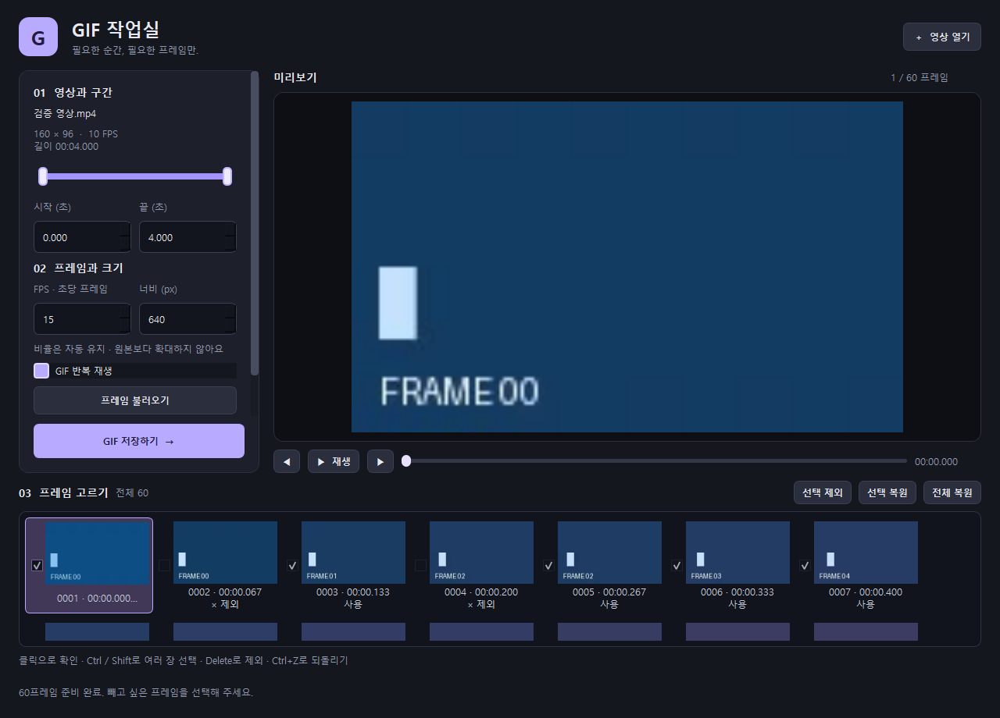

# GIF 작업실 사용법

영상의 원하는 구간을 골라 GIF로 저장하는 Windows 앱입니다. 구간, FPS, 출력 크기와 포함할 프레임을 조절할 수 있습니다. 영상 효과 기능은 없습니다.

[English README](../README.md)



## 실행

### 실행 파일

빌드된 **`GIF작업실.exe`**가 있다면 더블클릭해서 실행하세요. Python이나 FFmpeg를 따로 설치하지 않아도 됩니다. 실행 파일 하나만 다른 폴더로 옮겨 사용할 수 있습니다.

이 저장소에는 소스와 빌드 스크립트를 올려 두었습니다. 생성된 exe는 Git에 포함하지 않으며, 아래 빌드 방법으로 만들 수 있습니다.

### 소스에서 실행

**Windows x64**, **Python 3.11 이상**이 필요합니다.

```powershell
git clone https://github.com/yuudong123/gif-workshop.git
cd gif-workshop
py -3 -m venv .venv
.\.venv\Scripts\python.exe -m pip install -r requirements.txt
.\.venv\Scripts\python.exe app.py
```

변환에 사용하는 FFmpeg는 `imageio-ffmpeg` 패키지가 제공합니다.

## GIF 만들기

1. **영상 열기**를 누르거나 영상 파일을 창에 드래그하세요. 처음 최대 5초의 프레임을 자동으로 불러옵니다.
2. **시작·끝 시간**을 초 단위로 입력하거나 구간 막대의 양쪽 손잡이를 드래그하세요.
3. **FPS**를 정한 뒤 **프레임 불러오기**를 누르세요. 구간이나 FPS가 바뀌면 목록을 다시 만들어야 합니다. 이때 제외 목록은 초기화되며, 기존 제외가 있으면 확인창이 나옵니다.
4. 프레임을 클릭해서 확인하세요. **Ctrl / Shift**로 여러 장을 고른 뒤 **선택 제외** 또는 **Delete**를 누르세요. 체크박스나 더블클릭으로도 제외·복원할 수 있습니다.
5. **선택 복원**, **전체 복원**, **Ctrl+Z**로 되돌릴 수 있습니다. 미리보기 재생은 사용 프레임만 순서대로 보여 줍니다.
6. **너비**와 **GIF 반복 재생**을 정하고 **GIF 저장하기**를 누르세요. 저장할 파일 이름과 위치를 선택하면 됩니다.

제외한 프레임의 시간은 GIF에서도 제거됩니다. 예를 들어 10 FPS에서 16장을 남기면 약 1.6초짜리 GIF가 됩니다. 출력 너비만 바꿀 때는 기존 프레임 선택이 유지됩니다.

## 단축키

| 단축키 | 기능 |
| --- | --- |
| Ctrl+O | 영상 열기 |
| Ctrl+S | GIF 저장 |
| Space | 미리보기 재생·일시정지 |
| Delete | 선택한 프레임 제외 |
| Ctrl+Z | 마지막 제외·복원 작업 되돌리기 |

## 범위와 동작

- **FPS 1~50**, **출력 너비 64~1920px**, **최대 3,000프레임**을 지원합니다. 긴 영상은 구간을 줄이거나 FPS를 낮춰 주세요.
- MP4, MOV, MKV, AVI, WEBM 등의 일반적인 영상은 FFmpeg로 처리합니다. 실제 지원 여부는 파일의 코덱과 손상 여부에 따라 달라집니다.
- 프레임 비율을 유지하며 원본보다 확대하지 않습니다. 미리보기는 최대 640px, 저장은 설정한 너비로 원본에서 다시 추출합니다.
- GIF에는 소리가 포함되지 않습니다. 프레임 지연은 10ms 단위이며, 재생 프로그램에 따라 빠른 FPS의 표현이 달라질 수 있습니다.
- 편집과 저장에 임시 디스크 공간을 사용합니다. 큰 해상도나 긴 구간은 공간과 시간이 더 필요합니다.
- 원본 영상은 수정하지 않습니다. 저장 실패나 취소 시 기존 GIF를 보존합니다.

## 단일 exe 빌드

```powershell
.\.venv\Scripts\python.exe -m pip install -r requirements-dev.txt
.\.venv\Scripts\python.exe build_app.py
```

프로젝트 폴더에 **`GIF작업실.exe`**가 생성됩니다. 변환 도구, 문서와 라이선스 고지를 포함합니다.

## 검증

```powershell
.\.venv\Scripts\python.exe qa_check.py
.\.venv\Scripts\python.exe verify_bundle.py
```

첫 명령은 실제 H.264 검증 영상을 생성해 구간 선택, 프레임 순서와 제외, 재생 시간, 반복, 취소와 편집 화면을 확인합니다. 결과는 `.qa/`에 저장합니다.

두 번째 명령은 Python과 FFmpeg를 `PATH`에서 제외한 상태로 exe를 실행해 GIF 저장을 확인합니다. 앱 창이 잠시 열렸다가 검증을 마치면 닫힙니다. 생성한 검증 영상으로 확인하는 것이며, 모든 코덱과 재생 프로그램의 호환성을 보장하는 검사는 아닙니다.

## 라이선스

Copyright © 2026 yuudong123. 프로젝트의 자체 소스는 **GPL-3.0-or-later**로 공개합니다. 전문은 [LICENSE](../LICENSE)에 있습니다.

외부 라이브러리는 각각의 라이선스를 유지합니다. Qt/PySide6, Pillow, imageio-ffmpeg와 FFmpeg의 고지는 [THIRD_PARTY_NOTICES.txt](../THIRD_PARTY_NOTICES.txt)를 참고하세요.
